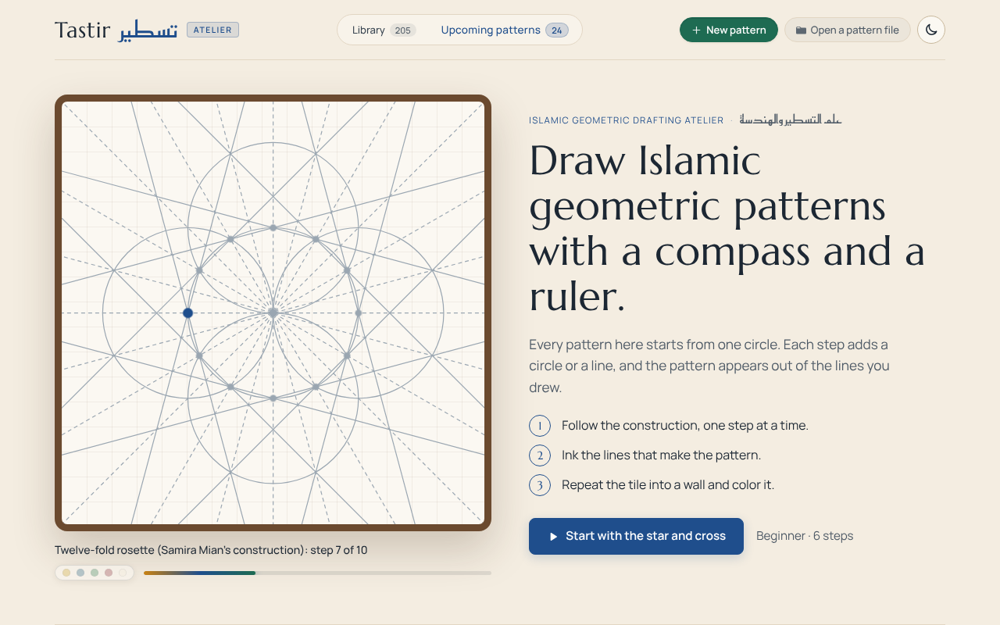
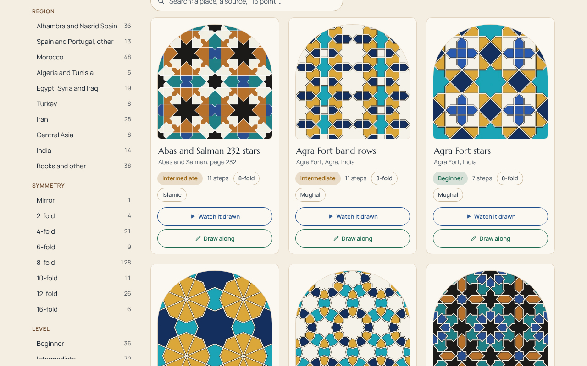
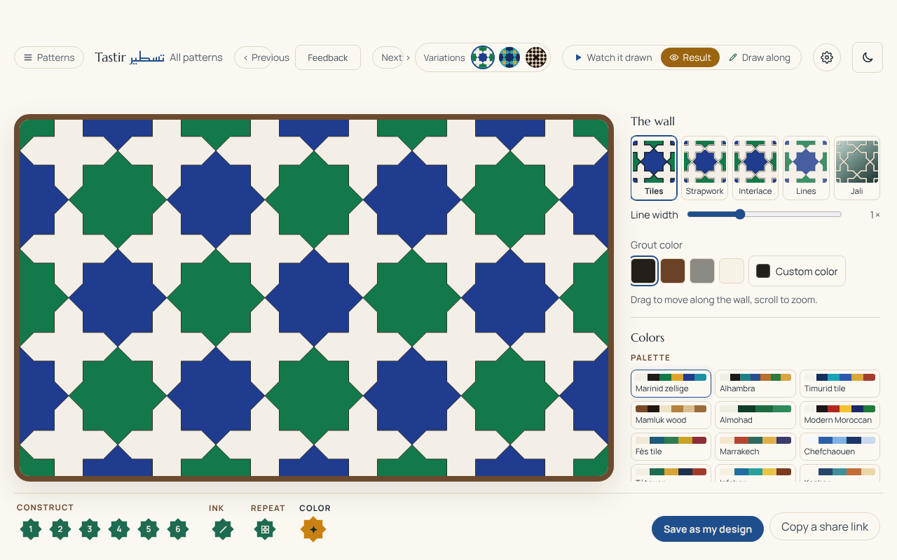

# Tastir تسطير

**Learn to draw Islamic geometric patterns the way craftsmen did, with only a compass and a ruler.**

### [▶ Open the live app: tastir-studio.vercel.app](https://tastir-studio.vercel.app)



Tastir walks you through a real pattern one step at a time. Each step draws one exact circle or line, and the star pattern appears out of the lines you drew. You then ink the pattern, repeat its tile into an endless wall, and color it piece by piece. The library holds more than 200 designs from the Alhambra, Fès, Isfahan, Cairo, Agra and elsewhere, many checked against photos of the real walls.

| Pick a pattern from the library | Finish it as a colored wall |
| --- | --- |
|  |  |

## What you can do

- **Watch it drawn** or **draw along** beside any beginner, intermediate or advanced tutorial.
- **Finish the wall** as tiles, strapwork, line drawing, a pierced *jali* screen, or woven interlace, with historical palettes such as Alhambra, Marinid zellige and Timurid tile.
- **Make your own** pattern in the construction editor, save it in your browser, export it as a file, or share it as a link that carries the whole design (nothing is uploaded).
- **Draw with an AI.** The Studio is an MCP server, so Claude, ChatGPT or Codex can connect to it and build a pattern from ruler-and-compass steps on the same drawing you are editing ([how to connect](docs/STUDIO-CONNECT.md)).

## How it is built

The core idea is that a pattern is a construction, not a picture. Tutorials are JSON that never contain coordinates: every point is a crossing of earlier circles and lines, and the engine refuses any reference that is missing or ambiguous, naming the step that caused it. That makes the geometry exact and testable.

- **Geometry engine** (`packages/engine`): pure TypeScript with no DOM and no runtime dependencies. It evaluates constructions, finds the closed pieces of the ink, and runs the same in tests, in a Web Worker, and on the server.
- **Golden tests**: every tutorial has a test built from its expected pieces, so an engine change that alters any pattern fails the build.
- **Player** (`apps/player`): React 19, Vite and SVG. Opening a tutorial evaluates it in a Web Worker so the page stays responsive on large patterns.
- **Studio** (`apps/studio`): a shared drawing space with revision-checked edits and per-author undo, served as a Vercel function with Neon Postgres, Google sign-in, and a Cloudflare Durable Object that pushes changes live. AI agents reach it through the Model Context Protocol.
- **Tooling**: an Nx and pnpm monorepo, Zod schemas, Vitest, and Playwright browser tests on desktop, tablet and phone viewports.

## Run it locally

You need Node 22.12 or newer and pnpm 10.

```bash
pnpm install --frozen-lockfile
```

```bash
pnpm dev
```

Then open http://localhost:4200. Library previews are generated automatically.

## Repository map

| Path | What it holds |
| --- | --- |
| `packages/engine` | Geometry, construction evaluation, inking and piece finding |
| `packages/schema` | Validation for tutorials, drafts and share links |
| `packages/project-core` | The drawing and the commands that edit it, shared by the editor, the assistant and the Studio |
| `packages/agent-protocol` | Shared contracts for AI observation, highlighting and drawing |
| `apps/player` | The web app: library, lessons, draw along, editor, walls and coloring |
| `apps/studio` | The hosted Studio server and its MCP endpoint |
| `apps/live-room` | The Cloudflare Worker that delivers live updates |
| `apps/agent-local` | The local ChatGPT drawing assistant |
| `tutorials/` | Tutorial source JSON, each checked by a golden geometry test |
| `docs/` | Product decisions, pattern verification and working notes |

## Contributing

Start with [the project overview](docs/PROJECT.md), [the tutorial format](docs/tutorial-format.md) and [how steps are written](docs/tutorial-writing.md). Read [the geometry notes](docs/geometry-notes.md) before changing construction or piece finding, because each note records a bug that already happened once. [Pattern status](docs/patterns/STATUS.md) records how each design was verified; passing geometry tests alone does not show that a design matches a historical example.

Tutorial text and drawings are always original. A construction taken from a book, video or website is credited in the tutorial's `credits`, and only free (public domain or Creative Commons) photos are shipped.

### Checks

Install the test browser once, then run every check:

```bash
pnpm exec playwright install chromium
```

```bash
pnpm check
```

`pnpm check` runs lint, strict TypeScript, the geometry and UI tests, the production build, and the Chromium browser tests. Run checks one at a time, because the build and TypeScript checks share generated output. The individual commands are `pnpm lint`, `pnpm typecheck`, `pnpm test`, `pnpm build`, `pnpm test:browser` and `pnpm test:agent:browser`.

GitHub Actions is disabled at the owner's request, so tests run locally and the Pages workflow is manual-only.

<details>
<summary>More for contributors: parallel worktrees, the local AI assistant, and the layout audit</summary>

#### Working beside another agent

Use a separate worktree and a different port:

```bash
git worktree add ../Tastir-my-work -b my-work
```

```bash
cd ../Tastir-my-work && pnpm install --frozen-lockfile && pnpm nx run player:dev --port=4290 --strictPort
```

#### The local drawing assistant

Run `pnpm dev:agent` and open http://127.0.0.1:4291/#/agent. Connect your ChatGPT account to ask about the current drawing, highlight named objects, construct new lines, circles and crossings from O and A, ink sides between named points, repeat the tile and paint it. Every assistant edit has one Undo, and Keep in My patterns saves an editor copy. Automated tests use simulated model responses. See [the setup guide](docs/AI-AGENT-SETUP.md) and [the full plan](docs/AI-AGENT-PLAN.md).

#### The draw-along layout audit

With the dev server running on port 4290, run `node tools/check-draw-along.mjs`. It draws and inks seven tutorials, repeats and colors them, and measures both boards at every stage at five screen sizes, writing measurements and screenshots to `docs/review/codex-layout/`. Set `TASTIR_URL` to use a different dev server, and run it after build and catalog commands finish so dev-server reloads do not interrupt it.

#### Generated files and private pages

Generated previews, reports and browser traces are ignored by Git. `pnpm catalog` rebuilds the library metadata and thumbnails, and adding a tutorial needs no app code. The dev server also has `#/review`, `#/notes` and `#/plan`; private research and internal review pages are left out of the production build. Do not add private reference photos to public assets.

</details>
