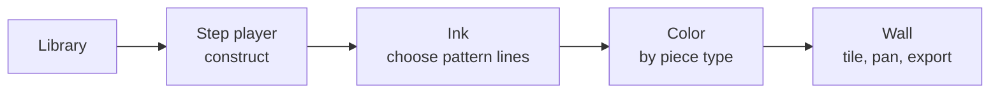
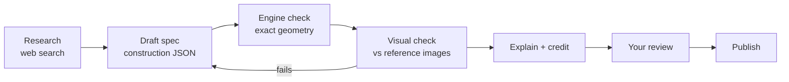
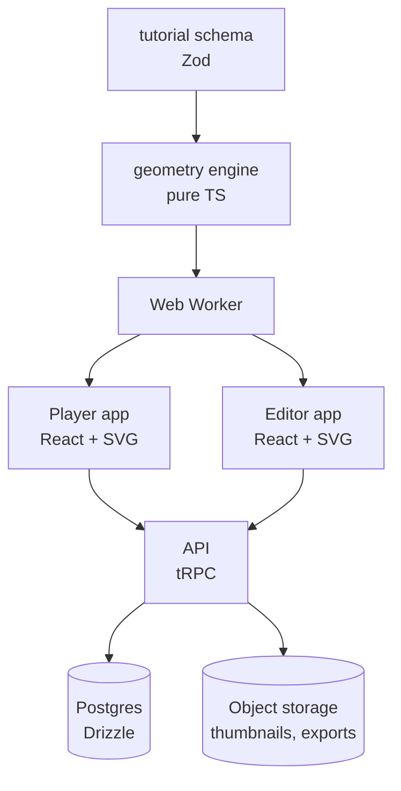

# Tastir — PRD

Sep 25, 2026 · Yahya

## Summary

Tastir is a web app that walks people through Islamic geometric pattern tutorials one step at a time. Each press of **Next** draws the next compass circle or ruler line exactly. At the end the finished pattern can be colored piece by piece and repeated into an infinite wall.

The user never measures, never hunts for an intersection, and never needs drawing software. Each tutorial is a list of steps like "circle centered on this crossing, touching that line"; the app turns them into exact geometry and animates them.

The core technology already exists as a prototype (Zellige Studio): exact constructions, intersection detection, piece extraction from line arrangements, step animation, palettes, and infinite tiling with pan and hover. This PRD turns it into a product built around tutorials.

## Problem and target users

Following a pattern tutorial today means paper, compass and ruler, or general drawing software (Illustrator, Inkscape, GeoGebra) that is hard to use for this. Small errors compound: a circle drawn 1 mm off moves every later intersection, and beginners give up before the pattern appears.

PDF tutorials, such as those on Sandy Kurt's free tutorials page, describe steps in words ("point the compass on the intersection of 2 lines and draw a circle tangent to the vertical and diagonal line") plus a static picture. Readers must work out which intersection is meant, and there is no way to check their drawing.

| User | Need | What they get |
| --- | --- | --- |
| Hobbyist or beginner | Learn how patterns are built without tools or mess | Guided steps, exact drawing, instant result to color |
| Teacher or parent (maths, art, heritage classes) | A class-ready way to show geometry from one circle | Step replay, big-screen mode, printable sheets |
| Artist or designer | A starting point for original work | Finished line work and pieces exported as SVG |
| Pattern designer (phase 5) | Publish their own patterns as interactive tutorials | A step editor that checks every step for exactness |

Primary persona for v1: the hobbyist on a desktop or laptop who has seen a pattern (a zellige wall, a tile) and wants to understand and recreate it.

## Goals, non-goals, success metrics

**Goals**

1. A learner can finish a 20-step tutorial in under 10 minutes using only Next, Back and a color picker.
2. Every drawn element is geometrically exact and traceable to the step that made it.
3. The finished pattern can be colored by piece type and viewed as an infinite, pannable wall.
4. Tutorials are data, not code: the AI pipeline adds one without code changes.

**Non-goals for v1**

- Free-form drawing or a general CAD tool.
- Automatic pattern generation from a photo.
- Native mobile apps. v1 is desktop-first; tablet layouts come later.
- Physical fabrication output (tile cutting files) beyond SVG export.

**Success metrics** (first 3 months after launch)

| Metric | Target |
| --- | --- |
| Tutorial completion rate (reached final step / started) | ≥ 60% |
| Median time to finish a 20-step tutorial | ≤ 10 min |
| Colored-and-saved or exported patterns per finished tutorial | ≥ 0.5 |
| Tutorials in the library | 12 at launch, 30 by month 3 |
| Geometry defects reported per tutorial | 0 after the pipeline's checks pass |

## Core user experience

The learner moves through four stages: pick a tutorial, construct it step by step, ink the pattern, then color and repeat it.



**Library.** Cards show the finished pattern, fold (6, 8, 10, 12, 16), difficulty, step count and sources. Filters: fold, region style (Moroccan, Persian, Andalusian), level.

**Step player** (the heart of the app)

- The canvas shows every element drawn so far; the newest step is highlighted and older ones fade to light grey.
- Next and Back move one step; a slider scrubs the whole tutorial. Keyboard: arrows, space.
- Each step animates as it would by hand: the compass swings the circle, the ruler draws the line, and new crossings pop in as dots.
- The step text explains the step in plain words; the elements it names ("the intersection of the 2 squares") flash on hover.
- Later (phase 4), a "Try it" mode: the learner taps where they think the compass point goes, and the app confirms or shows the right point.
- Zoom and pan at any time; a close-up view for fine steps.

**Ink.** Each tutorial ships a default inking: the classic design, which the app thickens while erasing the construction (toggle to show it again). Users can switch to free inking and pick their own segments between crossings to make variations, then return to the default in one click.

**Color.** The app finds every closed piece. Tapping a piece opens a palette; every identical piece takes the same color, as in real zellige. Palettes: presets (Fès, Isfahan, and others), custom palettes, and Reset to the tutorial's default palette.

**Wall.** The finished repeat unit tiles infinitely. Drag to pan, scroll to zoom, hover a piece to highlight every copy.

**Save and share.** Save progress and colorings to an account. Export SVG, PNG and a printable A4/Letter line sheet for coloring by hand. Share a link to a colored pattern.

**Key user stories**

- As a beginner, I press Next and see exactly which point the compass goes on, so I never get lost.
- As a learner, I go Back two steps to rewatch how a circle was placed.
- As a colorist, I tap one star and all 24 stars change color.
- As a teacher, I project the step player full-screen and step through it with the class.
- As a designer, I export the finished lines as SVG and use them in my own work.

## The tutorial format

A tutorial is a JSON document written in a small construction language. Every element is defined only from earlier elements, never from coordinates, exactly as a compass-and-ruler drawing is. This makes every tutorial exact at any scale and lets the app explain each step.

**Primitives**

| Kind | Defined by | Example |
| --- | --- | --- |
| point | intersection of two elements (+ which one), a circle's centre, a named start point | `X(sq1.side2, sq2.side3)` |
| line | two points; or a point + parallel/perpendicular to a line; or an angle bisector | `par(through: p7, to: vert)` |
| circle | centre + radius from two points; or centre + tangent to a line or circle | `circle(c: q1, tangent: [vert, diag1])` |
| polygon | ordered points (squares, octagons) | `poly(q1..q8)` |
| group | a repeat of any step by rotation or reflection | `rot8(step 5)` |

Intersection points are chosen by rule, not index, so each step says exactly which point it means: `nearest-to(p)`, `on-ray(angle)`, `inside(circle)`, `first/second along line`.

**Steps.** Each step lists the elements it creates, the text shown to the learner, the elements to highlight, and how to animate them (compass swing, ruler stroke, fade).

**Stages.** After construction come the ink step (a list of segments, each between two named crossings on one line) and the pattern definition: the repeat unit (square, rectangle or hexagonal cell) and the default colors per piece type.

Example, steps 4–5 of the 8-fold zellige tutorial:

```json
{"id": 4, "text": "Point the compass on one of the intersections of the 2 squares and draw a circle tangent to the vertical and diagonal line",
 "create": {"c4": {"circle": {"centre": "X(static.side0, dynamic.side0)", "tangentTo": ["vert", "diag45"]}}},
 "highlight": ["vert", "diag45"], "animate": "compass"}
{"id": 5, "text": "Do the same on the other intersections and the centre",
 "create": {"c5": {"repeat": "c4", "by": "rot8", "plus": {"circle": {"centre": "O", "radiusOf": "c4"}}}}}
```

Because the format is declarative, one file drives the player, the "Try it" checks, the ink step, printing and export.

The concrete v0 of this format, with a complete worked tutorial, is in `docs/tutorial-format.md`.

## Geometry engine

The engine is a pure TypeScript library with no UI dependencies, so it runs in the browser, in a Web Worker, and in tests. It evaluates a tutorial into a scene: every point, line, circle and piece, with the step that created it.

**Evaluation**

1. Parse and validate the tutorial (references exist, no cycles, steps in order).
2. Evaluate elements in step order into a dependency graph (a DAG); each element stores its inputs, so the player can highlight why a point exists.
3. Compute intersections lazily: line–line, line–circle and circle–circle, each returning a stable, ordered list.
4. Solve tangency constructions in closed form: circle at a centre tangent to a line (radius = distance), to a circle (outer and inner), or tangent to two lines (angle bisector).

**Precision.** 64-bit floats with a relative tolerance of 1e-9 of the drawing size. Points closer than the tolerance are merged. Tangency is checked by a discriminant near zero, and tangent points are reported as one point, not two.

**Pieces.** After inking, the engine builds a planar arrangement:

- Split every inked segment at every crossing (spatial grid for speed).
- Build a half-edge graph; remove dangling ends; walk the closed faces.
- Class faces by congruence (vertex count, area, perimeter, sorted side lengths) so identical pieces share one color.
- Optional tidy pass that flags slivers too thin to cut (area / perimeter² < 0.02) for the pipeline to fix.

**Repetition.** Given the repeat cell, the engine evaluates the unit, inks it, and computes pieces over a 3×3 neighbourhood so pieces that cross the cell edge are whole. The renderer then tiles the cell.

**Performance targets:** evaluate a 40-step tutorial in < 50 ms; compute pieces for a 16-fold repeat (≈ 3,000 segments) in < 300 ms in a worker.

The prototype already has line/circle intersections, Hankin and rosette motifs, the arrangement and face walk, congruence classes and 3×3 tiling; these move into this library with tests.

## Rendering, animation, and interaction

The canvas is SVG, because it is resolution-independent, exports directly and supports hit-testing. The wall view uses an SVG `<pattern>` fill for the repeat, so the infinite tiling costs one cell's worth of nodes.

| Layer | Contents | Style |
| --- | --- | --- |
| Construction | circles, lines, polygons from finished steps | thin, light grey |
| Current step | elements created by this step | tutorial color, 2× width, animated |
| Marks | crossings and tangent points | small dots, pop-in |
| Ink | chosen pattern segments | dark, adjustable width |
| Pieces | filled faces | palette colors, grout gap |
| Highlight | hovered piece type, hovered referenced element | outline + dim others |

**Animation.** Stroke-dash animation with the Web Animations API: circles sweep from the compass point, lines draw from one end, marks scale in. Default 0.8 s per step, with a speed control and a reduced-motion setting that skips it. Back reverses the animation.

**Camera.** Pan (drag, arrow keys), zoom (wheel, pinch), and an "auto-frame" that fits the current step's elements. A step can set its own camera, for close-up steps like step 19's central rosette.

**Hit-testing.** Pieces: point-in-polygon on the cell after mapping the pointer into cell coordinates (already built for the prototype's hover). Construction elements: distance to curve under 6 px.

**Accessibility.** Every step's text is live-announced; all controls work by keyboard; color picking has named colors and a contrast check between neighbouring pieces.

## Coloring and pieces

Color is applied per piece type, never per pixel: tapping one piece colors every congruent piece, as a zellige craftsman cuts all identical pieces from one glaze.

- **Piece panel.** Lists each piece type with its shape, count per repeat and current color. Hovering highlights every copy on the wall.
- **Scope toggle.** "All identical pieces" (default) or "this ring only", for designs where the same shape takes different colors by position (the prototype's ring-by-ring glazing).
- **Palettes.** Presets (Fès, Marrakech, Chefchaouen, Tétouan, Isfahan, Kashan), user palettes, an eyedropper from an uploaded photo, and Reset to the tutorial's default palette.
- **Grout and style.** Grout width and color; three styles: tiles, strapwork (bands), line-only for printing and hand-coloring.
- **History.** Undo/redo for color changes; colorings are saved separately from the tutorial so one tutorial can have many colorings.

Each tutorial ships a default coloring. The app never forces it; Reset returns to it.

## Content pipeline: AI-built tutorials

Tutorials are researched, written and checked by an AI pipeline, not by human authors. Designers publishing their own patterns come later (phase 5).



1. **Research.** An agent searches the web for the pattern: constructions, free tutorials, write-ups, and photos of real examples. It saves every page it uses, with its URL.
2. **Draft.** The model writes the tutorial as construction JSON only: every point comes from crossings and tangencies, never typed coordinates.
3. **Engine check.** The engine rejects any step whose references are missing, ambiguous or impossible (e.g. a tangent circle that cannot exist). Errors go back to the model with the exact reason.
4. **Visual check.** The engine renders the finished pattern and it is scored against the reference images. The scorer is the prototype's colour-density comparison, plus a vision model comparing each step's drawing with its words. Below a threshold, the draft loops back (up to 5 rounds), then goes to review as "needs help".
5. **Explain and credit.** The model writes plain-language step text, the "why" for key steps, and which elements to highlight.
6. **Your review.** A short internal review page shows the tutorial, its scores and its sources; you approve or send it back. AI can be confidently wrong about geometry, so nothing publishes unseen.

**Credit rules**

- General knowledge needs no credit: dividing a circle, the static and dynamic squares, star-and-cross, Hankin's method.
- A specific construction sequence, named design or explanation taken from one book, PDF, video or post is credited by name and link, on the tutorial page and on the steps that use it.
- Step text and drawings are always the app's own: written fresh and drawn by the engine, never copied. Credit is not permission, so a close adaptation of one specific published tutorial should be avoided or cleared with its creator.

**In-app AI tutor (phase 4).** A "why?" button on each step: the model answers using the step's dependency graph (which crossing, which circle, why this radius), not guesswork.

## Architecture and tech stack

A TypeScript monorepo with the geometry engine as its own package, so the web player, the editor and any future mobile app share it.



| Layer | Choice | Why |
| --- | --- | --- |
| Repo | Nx monorepo, packages: `engine`, `schema`, `player`, `editor`, `api` | shared types; engine testable alone |
| Engine | TypeScript, no dependencies, runs in a Web Worker | keeps the UI at 60 fps during face finding |
| Schema | Zod, with JSON Schema exported for authors | one source of truth for validation |
| UI | React + Vite, SVG rendering, Zustand for player state | simple; SVG fits exact vector output |
| Animation | Web Animations API | pause, reverse and speed control built in |
| API | tRPC on Node | typed end-to-end with the client |
| Data | Postgres + Drizzle ORM; S3-compatible storage | relational data, generated thumbnails |
| Auth | Email magic link + Google | low friction for hobbyists |
| Hosting | Static front end on a CDN, API on a small container | cheap at low traffic |
| Tests | Vitest for the engine (golden tests per tutorial), Playwright for the player | geometry must never regress |

**Golden tests.** For each tutorial, the test suite stores the expected piece count, piece types and a hash of the inked segments. Any engine change that alters a published tutorial fails CI.

**Offline.** Tutorials are static JSON, so the player works as a PWA once a tutorial is cached.

**AI pipeline.** A background job runner (a queue on the API server) calls the Claude API with web search for research and with vision for the visual check. The engine runs in the same job to validate each draft. Each run stores its sources, drafts, scores and the model's reasoning, so a failed tutorial can be inspected and re-run.

## Data model and API

| Table | Key fields | Notes |
| --- | --- | --- |
| `tutorials` | id, slug, title, fold, style, level, status (researching / needs-help / in-review / published) | metadata for the library |
| `tutorial_versions` | tutorial_id, version, spec (JSONB), engine_version, golden_hash, visual_score | immutable; users' work points at a version |
| `sources` | id, url, title, creator, kind (book / pdf / video / post / photo), accessed_at | every page the research used |
| `credits` | tutorial_id, source_id, step_ids, note | shown on the tutorial page and its steps when not general knowledge |
| `pipeline_runs` | id, tutorial_id, stage, drafts, scores, log, status | inspect and re-run failed builds |
| `users` | id, email, display_name | |
| `progress` | user_id, tutorial_version_id, step, updated_at | resume where you left off |
| `colorings` | id, user_id, tutorial_version_id, palette (JSON), piece_colors (JSON), inking (default or custom segments), grout, style, public | many per tutorial |
| `palettes` | id, user_id (null = preset), name, colors (JSON) | |
| `exports` | id, coloring_id, kind (svg / png / pdf), url | generated in a worker |

**API (tRPC procedures)**

- `tutorials.list(filters)`, `tutorials.get(slug)` → metadata, credits and the latest published spec
- `progress.get/set(tutorialVersionId, step)`
- `colorings.create/update/list/get`, `colorings.share(id)` → public link
- `palettes.list/create/delete`
- `exports.create(coloringId, kind)` → signed URL
- Admin: `pipeline.start(topic, referenceImages?)`, `pipeline.status(runId)`, `review.list()`, `review.approve(versionId)`, `review.sendBack(versionId, note)`

Piece colors are stored by piece-type key (the congruence signature), so a coloring survives cosmetic edits to a tutorial but is flagged if a new version changes the pieces.

## Milestones

Six phases, each ending in something usable. Durations assume one developer part-time (about 10 hours a week).

| Phase | Scope | Exit criterion | Estimate |
| --- | --- | --- | --- |
| 0. Spike | Tutorial schema + engine for points, lines, circles, tangency; one hand-checked tutorial (8-fold star) in a bare player | all steps of one tutorial play exactly | 2–3 weeks |
| 1. Player MVP | Step player with animation, Back/Next/scrub, highlights, default and free inking, pieces, coloring, wall with pan/zoom, SVG/PNG export; desktop layout; no accounts | a friend finishes a tutorial unaided in < 10 min | 5–6 weeks |
| 2. AI pipeline | Research → draft → engine check → visual check loop, credits, internal review page | the pipeline produces 3 publishable tutorials with no hand edits to the JSON | 5–6 weeks |
| 3. Accounts and library | Auth, saved progress and colorings, library filters, share links, printable sheets, PWA | 12 tutorials; progress survives reload | 4 weeks |
| 4. Learning features | "Why?" AI tutor per step, "Try it" mode, classroom full-screen mode, tablet layout | learners use "why?" on ≥ 20% of tutorials | ongoing |
| 5. Designers | Click-to-construct editor for people to publish their own patterns | first outside pattern published | later |

**First three tutorials** for the pipeline (from classic constructions): the 8-fold star and cross, the classic 8-fold zellige (star with petals), and a 16-fold rosette. The third one proves the engine can reach patterns like the Fès panel.

## Risks, decisions and open questions

| Risk | Impact | Mitigation |
| --- | --- | --- |
| AI misreads or invents a construction | wrong geometry published, as happened when steps 11–16 of the 8-fold zellige PDF were rebuilt from its text alone | engine rejects impossible steps; visual score against reference images; your review before publishing |
| Sources are thin for complex patterns (16- and 24-fold panels) | pipeline stalls on the most wanted designs | start with well-documented patterns; loop with reference photos; mark "needs help" rather than publish a guess |
| Copying a specific tutorial too closely | copyright and goodwill problems, even with credit | step text and drawings always generated fresh; credit sources; avoid near-copies of one creator's sequence |
| Floating-point edge cases (tangency, near-coincident points) | missing or doubled pieces | tolerance merging, closed-form tangency, golden tests per tutorial |
| Face finding is slow on large repeats | laggy color step | Web Worker, spatial grid, cache pieces per tutorial version |
| API cost of research runs | budget, since the app is free | run the pipeline offline per tutorial, not per user; cache sources; players never call the model except for "why?" |

**Decisions**

- **Price:** free, at least early on. No revenue model or revenue share is needed for v1.
- **Inking:** users can choose their own segments; every tutorial ships a strong default (the classic design).
- **Platform:** desktop first; tablet layout in phase 4.
- **Content:** built by the AI pipeline from web research, with no partner authors. Specific sources are credited; designers may publish later (phase 5).
- **Reference images:** photos found by the research are used only inside the pipeline for scoring, never shown in the app, since they belong to their photographers.

**"Try it" mode — not in v1, added in phase 4.**

- v1's job is to prove that people finish tutorials. Watching an exact construction unfold is the core value, and it is cheap to build.
- "Try it" is where watching turns into learning, and the engine already knows the right answer, so it is easy to add later: the learner clicks a point, and the app accepts anything within a few pixels.
- It needs careful handling of wrong answers (hint, then show) to avoid frustration, which is better tuned once real users exist.
- A light version fits v1 at almost no cost: before each step animates, the elements it will use (the crossing, the two lines) flash first, so learners can predict where the compass goes.

**Open questions**

- [ ] Which three patterns the pipeline tackles first; the suggestion is the ones in Milestones.
