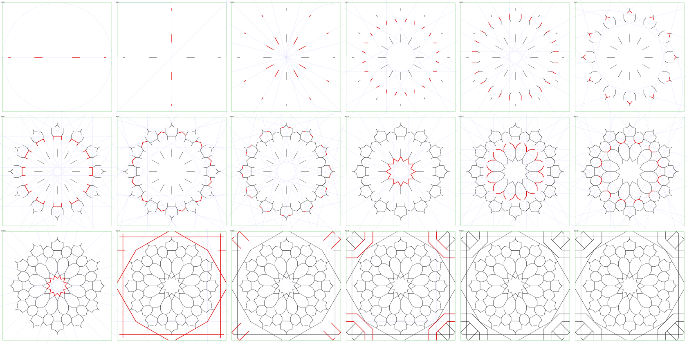

# Bou Inania twelve-fold wall: simple construction

A ruler-and-compass construction of the twelve-fold panel in the entrance stairway of the Bou
Inania madrasa, Fès, in 18 steps with no hidden step and no coordinates. It replaces the 21-step
`tutorials/bou-inania-twelve-fold-wall.json`, and cuts the ring round each corner star the way
the photo shows (see `bou-inania-wall-review-2026-10-09.md`, D1).

The matching tutorial JSON is `draft-bou-inania-twelve-fold-wall-simple.json` (same folder). It
was checked with my own Python rebuild, **not** with the app's engine. Run
`pnpm review` and `pnpm compare` on it before anything is approved.

## Frame and names

- **O** is the centre of one rosette. **A** is halfway to the next rosette on the right, so the
  rosettes sit on a square grid, twice OA apart. OA is the unit below.
- The **tile** is the square with corners at the four points **K** midway between four
  rosettes. An eight-pointed star sits at each K.
- Angles are measured about O, anticlockwise from OA. "The 30° line" means the line through O
  at 30°. "In the 30° direction" means parallel to it.
- **Turn it round** means `repeat rot12`: twelve copies about O, 30° apart. Copies are named
  `name@k`, turned by 30k°.
- Every point is a crossing or a tangency of earlier elements. Each step lists the crossings it
  uses.
- **Ink** runs `along` one line, from where one named element crosses it to where another does.
  The ink below is described for one copy. The repeat gives the rest.

## Steps

### 1. Circle and horizontal

- **Draw:** the circle `c` about O through A; the horizontal `h` through O and A.
- **Uses:** the given points O and A.
- **Highlight:** none.
- **Ink:** none yet.

### 2. Vertical, grid lines, tile corner, diagonal

- **Draw:** the vertical `v` through O, at right angles to `h`. Mark **N** where `v` cuts `c`
  at the top. Through A draw the grid line `gx` at right angles to `h`; through N the grid line
  `gy` at right angles to `v`. Mark **K** where `gx` and `gy` cross. Join O to K: the diagonal
  `r45`.
- **Uses:** `c ∩ v` (pick the top, 90°); `gx ∩ gy`.
- **Highlight:** `h`, `c`.
- **Ink:** none. The grid lines are not inked (they cross the ring, see step 16).

### 3. Divide the circle into 24

- **Draw:** with the compass still open to OA, the arc `cA` about A through O. Mark **P60**
  where it cuts `c` above the horizontal; join O to it: `r60`. Halve the angle A-O-P60: `r30`;
  mark **P30** on `c`. Halve A-O-P30: `r15`. Halve P60-O-N: `r75`. Then draw at right angles
  through O: `r105` ⟂ `r15`, `r120` ⟂ `r30`, `r135` ⟂ `r45`, `r150` ⟂ `r60`, `r165` ⟂ `r75`.
  There is now a line through O every 15°.
- **Uses:** `c ∩ cA` (pick 60°); `c ∩ r30` (pick 30°); the bisected angles.
- **Highlight:** `c`, `A`.
- **Ink (along the lines through O at 0°, 30°, 60°, 90°, 120°, 150°):** two runs each,
  given at their step: the petal tips (step 11) and the rim spokes (step 14).

### 4. Star lines (Samira Mian)

- **Draw:** mark **c45** where `r45` cuts `c` (45°) and **P255** where `r75` cuts `c`
  (on the far side, 255°). Join them: `F2`. Turn it round: twelve star lines, each joining two
  points of the circle 150° apart.
- **Uses:** `c ∩ r45` (pick 45°); `c ∩ r75` (pick 255°).
- **Highlight:** `c45`, `P255`.
- **Ink `F2`:** from where `F3` or `F4` meet it to where it reaches `F1` (distance .65–.71 from
  O): the outer sides of the rosette's arrowheads.

### 5. First corner and the 30° family

- **Draw:** join A to N: `an`. Mark **V9** where `an` crosses `F2`, the first corner of the
  rosette. Through V9 draw `F1` in the 30° direction (parallel to `r30`). Turn it round.
- **Uses:** `an ∩ F2`. This point is exact: the old tutorial's separate line `l9` is not
  needed.
- **Highlight:** `A`, `N`, `F2`.
- **Ink `F1`:** from V9 (on `F2`) out to `F8` (.71–.80).

### 6. Outer tip and the 135° family

- **Draw:** open the compass from O to K. Put its point on **V9b**, the corner of the same kind
  below and to the left of O, where `F1@1` crosses `F2@11`. Draw the circle `ck`. Mark **V13**
  where it cuts `h` on the right: the outer tip of the rosette (0.8560 from O). Through V13 draw
  `F3` in the 135° direction. Turn it round.
- **Uses:** `F1@1 ∩ F2@11`; radius O–K; `ck ∩ h` (pick 0°).
- **Highlight:** `O`, `K`, `V9b`.
- **Ink `F3`:** from `F7` or `F9` to the tip on the axis (.81–.86).
- **Open question Q1:** this compass move is exact, but it was chosen to hit the fitted tip. It
  is not a traditional move. See below.

### 7. Level and upright lines through C8

- **Draw:** mark **C8** where `F2@11` crosses `F3@10`, just above the horizontal on the right
  (at 6.6°). Through C8 draw `F4` in the level direction (parallel to `h`) and `F5` upright
  (parallel to `v`). Turn both round.
- **Uses:** `F2@11 ∩ F3@10`.
- **Highlight:** `F2@11`, `F3@10`.
- **Ink:** `F4` from `F13` to `F2`/`F3` (.59–.65). `F5` as one short bar between two `F3`
  copies, centred at .65.

### 8. The 75° family and helper F7

- **Draw:** mark **C9** where `F1@11` crosses `F2@11`: the first corner turned back by 30°, just
  above the horizontal (8.7°). Through C9 draw `F6` in the 75° direction, and the helper line
  `F7` in the 150° direction. Turn both round.
- **Uses:** `F1@11 ∩ F2@11`.
- **Highlight:** `C9`. Text without helpers drops `F7`.
- **Ink `F6`:** from `F2`/`F1` out to the next line through O (.71–.75). `F7` is not inked.

### 9. The 105° family and helper F9

- **Draw:** mark **C12** where `F3` crosses `F7`, near the outer tip. Through C12 draw `F8` in
  the 105° direction, and the helper line `F9` in the 15° direction. Turn both round.
- **Uses:** `F3 ∩ F7`.
- **Highlight:** `F3`, `F7`.
- **Ink `F8`:** the short piece from `F1` to `F3` (.80–.81). `F9` is not inked.

### 10. Petal sides

- **Draw:** mark **C2** where `r15` crosses `F9@2`, near the centre. Through it draw `F10` in
  the 150° direction. Turn it round.
- **Uses:** `r15 ∩ F9@2`.
- **Highlight:** `r15`, `F9@2`.
- **Ink `F10`:** the petal sides, from C2 out to the next line through O (.19–.27).

### 11. Petal shoulders

- **Draw:** mark **C5** where `F7@11` crosses `F9@5`, just above the horizontal, about halfway
  out. Through it draw `F11` in the 30° direction and `F12` in the 60° direction. Turn both
  round.
- **Uses:** `F7@11 ∩ F9@5`.
- **Highlight:** `F7@11`, `F9@5`.
- **Ink:** `F11` .42–.49. `F12` from `F11`/`F7` to `F1`/`F13` (.49–.54). The lines through O at
  0°, 30°, …, 150° get their inner runs now, from `F10` to `F11` (.27–.42): the petal tips.

### 12. Small stars

- **Draw:** mark **C6** where `F12` crosses `F1@11`. Through it draw `F13` in the 150°
  direction and `F14` in the 105° direction. Turn both round.
- **Uses:** `F1@11 ∩ F12`.
- **Highlight:** `F1@11`, `F12`.
- **Ink:** `F13` from `F1`/`F12` to `F4` (.54–.59). `F14` as one short bar between two `F1`
  copies, centred at .54.

### 13. Centre star

- **Draw:** mark **C0** where `F10@11` crosses `r30`. Through it draw `F15` in the 165°
  direction. Turn it round.
- **Uses:** `r30 ∩ F10@11`.
- **Highlight:** `r30`, `F10@11`.
- **Ink `F15`:** the twelve-pointed star at the centre (.14–.19).

### 14. Twelve-sided rim

- **Draw:** mark **P345** where `r165` cuts `c` (345°). Join P345 to c45: `hx`, a side of the
  hexagon inscribed in `c`. Mark **RA** where `hx` crosses `h`. Through RA draw `rim` at right
  angles to `h`. Turn it round. Mark **R45** where `rim@1` crosses `rim@2` (the rim's corner at
  45°), and draw the level line `oh` through it.
- **Uses:** `c ∩ r165` (pick 345°); `hx ∩ h`; `rim@1 ∩ rim@2`.
- **Highlight:** `P345`, `c45`.
- **Ink:**
  - The lines through O at 0°, 30°, …, 150°: their outer runs, from `F3` to the rim
    (.86–.90).
  - `rim` (the side across the 0° axis): the whole side between the eight-pointed stars above
    and below (from `SLr450@3` to `SLr450`). This is a straight grid band between two rosettes.
  - The other rim sides: from the grid line to `oh`. **This is the ring fix:** the rim line
    carries straight on across the ring round the star.
- **Open question Q2:** the rim distance is `cos 30° / cos 15°` = 0.89658. The photo fit gave
  0.89560. See below.

### 15. Eight-pointed star

- **Draw:** through K draw `ad` at right angles to `r45` (the other diagonal). Draw the circle
  `cs` about K with radius from RA to A. Mark **Sr450** where it cuts `r45` (pick nearest O),
  **Sad0** where it cuts `ad` (pick 90°), **Sad1** where it cuts `ad` (pick 0°). Draw the
  turned square's sides at right angles to the diagonals through them: `SLr450`, `SLad0`,
  `SLad1`.
- **Uses:** radius RA–A; `cs ∩ r45`; `cs ∩ ad` (two picks). The star is two squares: the
  rosette rims make one, and this one is turned by 45° with its sides the same distance from K.
- **Highlight:** `K`, `RA`, `A`.
- **Ink:** `SLr450` from the grid lines to the rim (the star's points towards O). `SLad0` and
  `SLad1` from the grid line to `ILr450` (step 16).

### 16. Ring of two octagons

- **Draw (inner octagon):** mark **Oi** where `oh` crosses `gx`. Draw the circle `ci` about K
  through Oi; it touches `oh`, which is one side of this octagon. Mark **Igy0** where `ci` cuts
  `gy` (pick 90°) and draw `ILgy0` at right angles to `gy` through it. Mark **Ir450** where `ci`
  cuts `r45` (pick nearest O) and draw `ILr450` at right angles to `r45` through it.
- **Draw (outer octagon):** draw the circle `co` about K through R45. Mark **Ugx0** where it
  cuts `gx` (pick 0°) and draw `ULgx0` at right angles to `gx`. Mark **Ugy0** where it cuts `gy`
  (pick 90°) and draw `ULgy0` at right angles to `gy`. Draw `ULr450` through R45 at right angles
  to `r45`.
- **Uses:** `oh ∩ gx`; radius K–Oi; `ci ∩ gy`; `ci ∩ r45`; radius K–R45; `co ∩ gx`;
  `co ∩ gy`.
- **Highlight:** `K`, `R45`, `oh`.
- **Ink:**
  - `oh` and `ILgy0`: from the grid line to `ILr450`.
  - `ILr450`: between `ILgy0` and `oh`.
  - `ULgx0` and `ULgy0`: from the grid line to `ULr450`.
  - `ULr450`: between `ULgx0` and `ULgy0`.
  - Nothing on the grid lines. With step 14's rim runs, the ring splits into 4 trapezoids on the
    axes (`ringaxis`) and 4 bent pieces on the diagonals (`ringbend`), as in the photo.
- The old tutorial's `ILgx0` was the same line as `oh`, and is dropped. The old second set of
  inner-octagon diagonal sides (`ILad0`, `ILad1`) is not needed for ink.

### 17. The other three corners

- **Draw:** turn K a quarter turn at a time about O (`repeat rot4`): `Ks`. Do the same with the
  star, the ring and the grid lines: `SLr450`, `SLad0`, `SLad1`, `oh`, `ILgy0`, `ILr450`,
  `ULgx0`, `ULgy0`, `ULr450`, `gx`, `gy`, `ad`.
- **Ink:** the copies of the step 15–16 runs.

### 18. Tile

- **Draw:** the square K, K@1, K@2, K@3.
- **Ink:** none.

## Result

The draft's `expect` block, from my piece finder: 16 types, 120 pieces per tile, total area 4.

| Piece | Vertices | Area | Per cell |
| --- | --- | --- | --- |
| centre | 24 | .0811 | 1 |
| arrowhead | 5 | .0752 | 4 |
| ringbend | 8 | .0684 | 4 |
| cross | 6 | .0623 | 2 (small) |
| arrow | 12 | .0569 | 12 |
| petal | 9 | .0522 | 12 |
| cornerstar | 16 | .0501 | 1 |
| shield | 9 | .0344 | 12 |
| pentagon | 9 | .0303 | 12 |
| arm | 5 | .0301 | 8 |
| ringaxis | 4 | .0294 | 4 |
| star | 9 | .0282 | 12 |
| gap | 4 | .0259 | 8 |
| diamond | 4 | .0089 | 8 |
| kite | 4 | .0068 | 12 (small) |
| chip | 4 | .0037 | 8 (small) |

Areas are rounded to 4 decimals. Let the engine set the exact values.

## Fit to the photo

Share of ink sample points on the white bands of the Commons photo (method in the review doc;
random placement scores about 0.51). Higher is better. Differences under about 0.005 are noise.

| Ink | Rosette | Grid band | Corner star |
| --- | --- | --- | --- |
| Current tutorial | 0.879 | 0.972 | 0.759 |
| Current tutorial, ring cut fixed only | 0.881 | 0.972 | 0.802 |
| This construction, rim by compass at the fitted distance | 0.882 | 0.973 | 0.803 |
| **This construction, hexagon rim (the draft)** | **0.882** | **0.974** | **0.799** |

The simple construction fits as well as the current one everywhere. The corner improvement
comes from the ring fix.

| | Current | This construction |
| --- | --- | --- |
| Steps | 21, one hidden | 18, none hidden |
| Hidden marks | 337 | 0 |
| Create entries | 457 | 94 |
| Ink paths | 420 | 364 |

## Open questions

- **Q1. Outer tip (step 6).** The radius O–K from V9b lands on the fitted tip exactly, but it
  was found to match, not taken from a tradition. The nearest 24-division chord (P15–P300 at
  0.8587) misses by 0.0027 OA. A published construction would replace it.
- **Q2. Rim (step 14).** The hexagon side gives 0.89658; the fit gave 0.89560 (+0.00097). Both
  score the same. The compass version is in `/workspace/bou-inania/render/simple_compass.json`.
  This is the owner's choice.
- **Q3. Helpers F7 and F9 stay.** `F8` and the `F10`–`F15` cluster can't be reached without
  them or a new anchor.
- **Q4. Rosette proportions are fitted.** The inner line families were read from the photo
  (repo's `tools/review/bou_inania/`) and then made exact by these crossings. Every set also lies
  within 0.004 OA of some crossing from a small pool of classic moves, so a close match is not
  evidence of the craftsman's method.
- **Q5. X and arrowhead proportions** between rosettes are not checked against a second photo
  (review D2).
- **Q6. `gap` piece.** It is coloured as ground. Not checked.
- **Q7. Engine check.** The `along` ink, the picks and the `expect` values have only been run
  through my rebuild.
- **Q8. Step images.** In `img/simple-step15.png` and `img/simple-step16.png` the corner copies
  already show before step 17. That is an artifact of my renderer, not the draft.

## Credits

- Photo: Robert Prazeres, "Bou inania DSCF2978.jpg", Wikimedia Commons, CC BY-SA 4.0,
  https://commons.wikimedia.org/wiki/File:Bou_inania_DSCF2978.jpg. The design was read from
  this photo. The construction is our own reconstruction, not a published one.
- Step 4 (star lines joining points 150° apart): Samira Mian,
  https://www.samiramian.uk/twelvefoldrosette.
